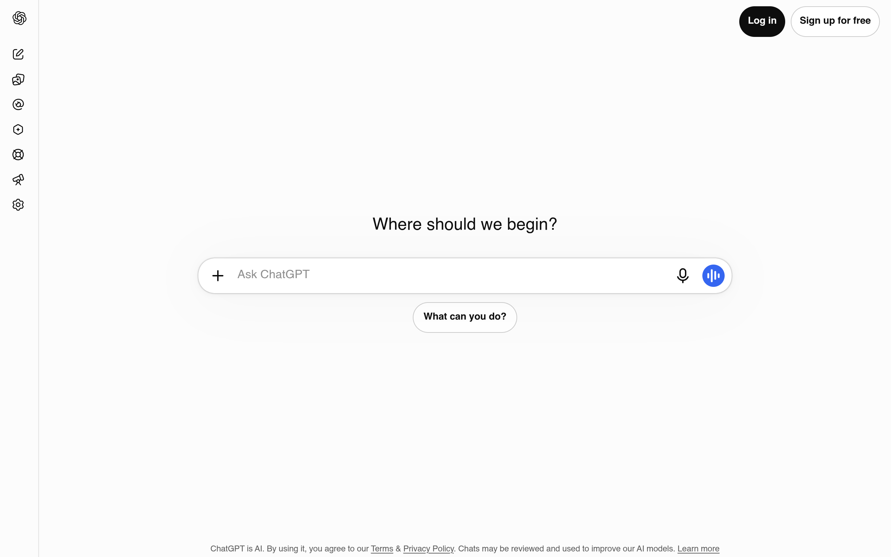
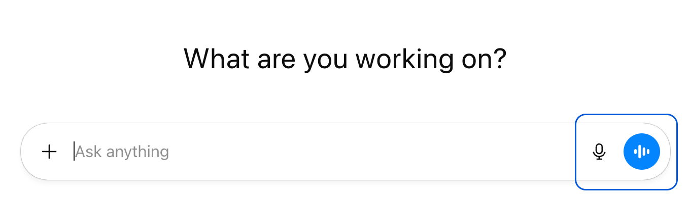
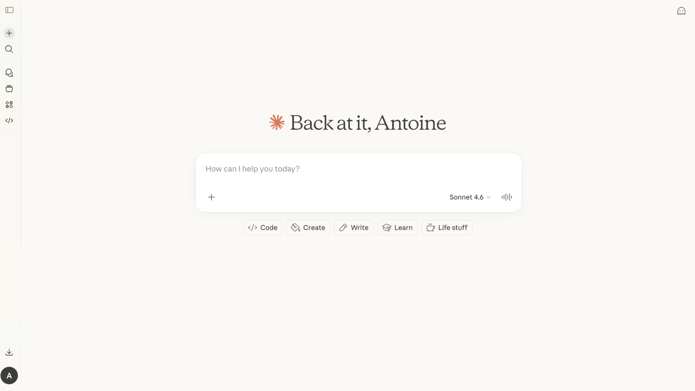
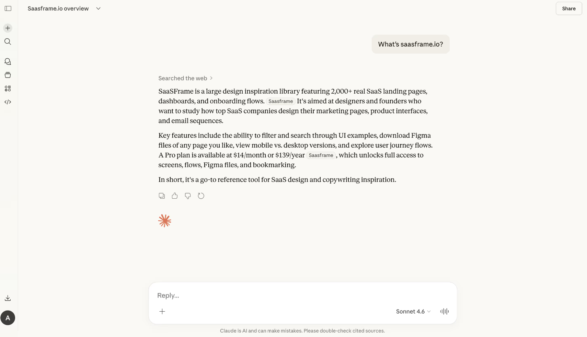
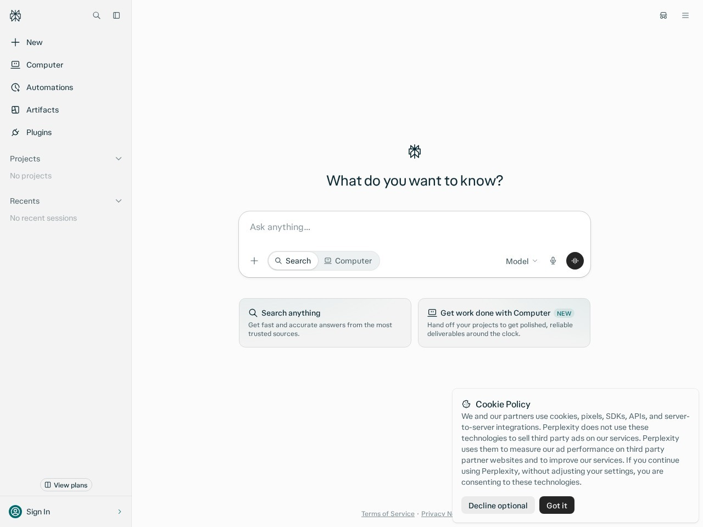
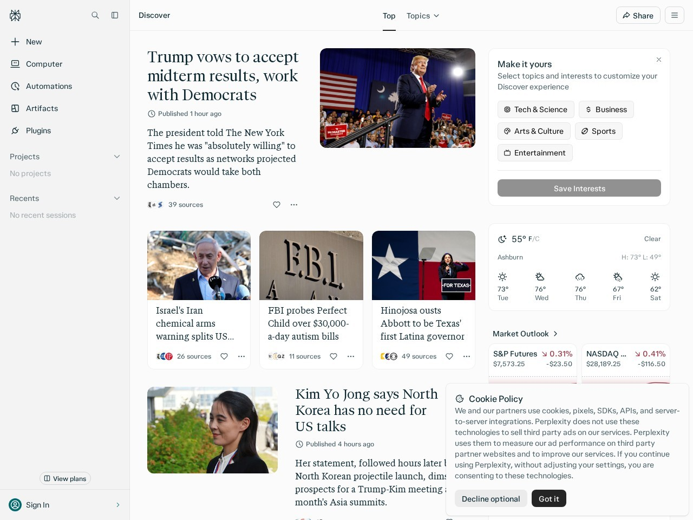

# T6 · UI moodboard

对标 ChatGPT、Claude、Perplexity 的浅色极简留白。本页只做研究，给 T7 一个可确认的视觉决定。

**检查点：请先确认本页，再开 T7（[#15](https://github.com/coppynight/posture-weapp/issues/15)）。** 确认前不要改 `wxss`、不要换皮、不要把样式合进 `main`。`main` 上的青绿皮（`f2bfd78`，PR #12）本票保持不动，等确认后由 T7 替换。

父规格：[#13](https://github.com/coppynight/posture-weapp/issues/13)。本票：[#14](https://github.com/coppynight/posture-weapp/issues/14)。

截图是第三方产品界面，只供内部对标，不进入小程序包体。

## 对标

三家都是浅底、中性灰、大留白、一条主操作。色相只出现在很小的标记上，不铺满页面。

### ChatGPT

登录前的首页 / 输入条。2026-11-04 截自 [chatgpt.com](https://chatgpt.com)。底 `#fcfcfc`，主按钮「Log in」实测 `#0d0d0d`，白字。左侧是细图标轨，中间一句问候加一条胶囊输入。语音钮是功能蓝 `#3566f0`，只占一个圆点。

同一条输入的官方近景，OpenAI Academy 素材，文件时间 2026-03-02。右侧蓝框是文章自己的标注，不是产品描边。

2026-07-21 从 chatgpt.com 样式表读到的浅色角色与截图一致：`--accent-primary` 为 `#000`，`--label-primary` 为 `#0d0d0d`，页面底为 `#fff`，用户气泡约为 `#f1f1f4`。

### Claude

新对话与对话中。2026-11-04 打开 claude.ai 时被 Cloudflare 拦住，所以用 [SaaSFrame 2026-02-19 收录的产品画面](https://www.saasframe.io/examples/claude-new-chat)，并裁到产品框内。对话页来自同日的 [chat feed](https://www.saasframe.io/examples/claude-chat-feed)。画面里的模型名是 Sonnet 4.6。

暖奶油底，实测约 `#faf9f5`。问候是衬线大字。唯一的色相是星标，星标像素平均约 `#da765a`。输入是白卡片、大圆角、发丝边，没有色块按钮。回答直接铺在奶油底上，不用重气泡。

### Perplexity

首页主工作面，2026-11-04 截自 [perplexity.ai](https://www.perplexity.ai)。底 `#fbfbfb`，侧栏 `#f3f3f3`，输入是大圆角白卡片，发送钮近黑（JPEG 上约 `#262626`）。右下角 Cookie 条是站点弹层，不是版式的一部分。

同一天的 Discover 面，用来看信息变密时是否仍守同一套语言：白卡片、发丝线、黑色实心按钮。行情里的红绿是数据语义，不是品牌色。

侧栏「Sign in」标记实测落在 `#046e64` 一带，和 T5 的 `#0f766e` 是同一族青绿。对标只吸收它的留白和黑按钮，不把这枚青绿带进小程序。

## 建议

浅底，中性灰做绝大部分表面和文字，**一个**强调色。

**推荐强调色：`#0d0d0d`（token 名 `color-primary`）。** 字在按钮上用 `#ffffff`（`color-on-primary`）。这是 ChatGPT 浅色主按钮的实测值，也是三家里实心主操作的共同选择（ChatGPT Log in、Perplexity 发送、Claude 登录页的邮箱按钮）。对比度：`#0d0d0d` 在 `#ffffff` 上约 19:1。

| 角色 | 建议值 | 用途 |
| --- | --- | --- |
| `color-bg` | `#f7f7f8` | 页面底。接近 ChatGPT `#fcfcfc` / Perplexity `#fbfbfb`，比纯白略沉，好托白卡片 |
| `color-surface` | `#ffffff` | 槽、报告卡、分享卡面板 |
| `color-ink` | `#0d0d0d` | 标题与正文 |
| `color-ink-secondary` | `#3f3f46` | 次级正文。在白底上约 10:1 |
| `color-muted` | `#5d5d67` | 说明、占位。在白底上约 6.5:1。不用 `#8f8f8f`（约 3.2:1，不够） |
| `color-line` | `#e6e6e6` | 发丝边、分割 |
| `color-primary` | `#0d0d0d` | 唯一强调色：主按钮、序号圆点 |
| `color-on-primary` | `#ffffff` | 强调色上的字 |
| `color-primary-soft` | `#f3f3f3` | 中性浅底，替换青绿洗底。需要免责条或标签底时用它 |
| `color-primary-ink` | `#0d0d0d` | 与正文同色。不再另设青绿字 |

`color-primary` 只用在主按钮和序号圆点上。免责声明、小节标题、选中槽的大面积底，都改回中性灰。

圆角：主按钮和底部主操作保持大圆角，接近胶囊（沿用 `--radius-pill`，控件大约 48rpx）。上传槽、报告卡、分享卡面板收到大约 32rpx，比现在的 40rpx 略紧，靠留白而不是靠鼓圆角分开。图片圆角大约 24rpx。序号继续用圆点。

字阶：继续一套无衬线，`PingFang SC` / `Noto Sans SC`。Claude 的衬线只出现在桌面问候里，不引进小程序。层次靠字号和字重：页面一个大标题（约 600），区块标题降一级，正文 400，说明用 `color-muted`。行高约 1.5。现有的 title / section / body / caption 四级够用。现在大量 700 读起来像海报，T7 把标题收到 600 即可。不改文案。

留白：一列。浅底上放白卡片，块与块之间的空隙大于卡片里的装饰。每屏一个实心主按钮。分隔用 `#e6e6e6` 发丝线，不加投影，不加插画。空的地方就留空。

## 废弃青绿，以及三面怎么落

T5 / PR #12 的青绿 token **废弃**。T7 从 `apps/weapp/src/theme.ts`（以及它生成的 `miniprogram/lib/theme.js`、`app.wxss`）拿掉这些色，上传页、报告页、分享卡都不再引用：

| 现 token | 现色 | T7 |
| --- | --- | --- |
| `color-primary` | `#0f766e` | `#0d0d0d` |
| `color-on-primary` | `#f4fffb` | `#ffffff` |
| `color-primary-soft` | `#d4efe8` | `#f3f3f3` |
| `color-primary-ink` | `#0c5c52` | `#0d0d0d` |

带绿相的中性色一起退出，否则底仍然发青：`color-bg #f5f7f7`、`color-ink #1c2422`、`color-ink-secondary #3e4a47`、`color-muted #55625e`、`color-line #dce3e1`。换成上一节的无彩灰。

流程仍是双图 → 报告 → 分享。文案结构不动。

**上传（`pages/capture`）**

- 页底 `#f7f7f8`。两个槽是白卡片，边为 `#e6e6e6`。已选中时用 `#0d0d0d` 细描边，不再铺 `#d4efe8`。
- 序号 1 / 2：黑底白字圆点。
- 「开始分析」：黑底白字。还不能提交时，按钮保持中性灰（现在的 `btn-muted` 角色还在，只是不再挨着青绿）。
- 重拍说明：白卡片加深色字，不另做一套警告色。

**报告（`pages/report`）**

- 免责声明仍在最上方，靠位置和字重醒目。底改为 `#f3f3f3` 或白卡片，标题 `#0d0d0d`，正文 `#3f3f46`。去掉青绿洗底和青绿小标题。
- 严重程度标签：`#f3f3f3` 底、`#3f3f46` 字。不用第二色相。
- 动作序号与上传页同一枚黑圆点。
- 「保存分享卡」黑底白字。「再来一次」白底加 `#e6e6e6` 描边。

**分享卡（`src/share-card.ts` 里的 `BACKGROUND` / `BAND` / `BAND_HEADING` / `ACCENT` / `BADGE` / `BADGE_INK`）**

- 整张底 `BACKGROUND` → `#f7f7f8`。
- 顶部免责带 `BAND` 现在是 `primarySoft` → `#f3f3f3`。带内标题 `BAND_HEADING` 现在是 `primaryInk` → `#0d0d0d`。
- 「主要问题」「动作要点」现在用 `ACCENT`（`primaryInk`）→ `#0d0d0d`，靠字重和空行分节。
- 序号 `BADGE` 现在是 `#0f766e` → `#0d0d0d`，字 `BADGE_INK` → `#ffffff`。
- 白面板 `PANEL` 仍是 `#ffffff`。分享卡与小程序同一套 token，不单独做一套海报色。

## 确认后再开 T7

请确认三件事：

1. 浅底 + 中性灰 + 单一强调色 `#0d0d0d`，可以交给 T7。
2. 青绿 `#0f766e` / `#d4efe8` / `#0c5c52` / `#f4fffb` 以及带绿相的中性色，按上面的表替换。
3. 上传、报告、分享卡只换这套语言，不改流程和文案。

确认前 T7（[#15](https://github.com/coppynight/posture-weapp/issues/15)）保持未就绪。本票没有改任何样式代码。
