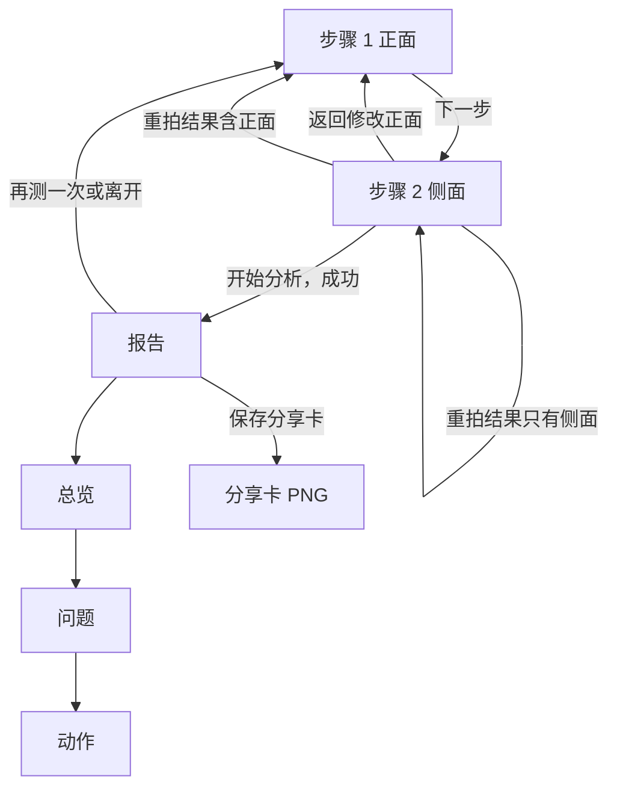
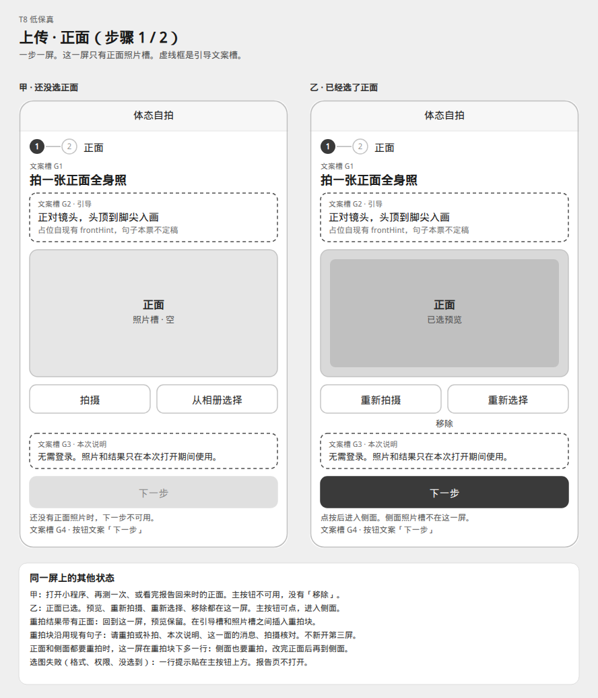
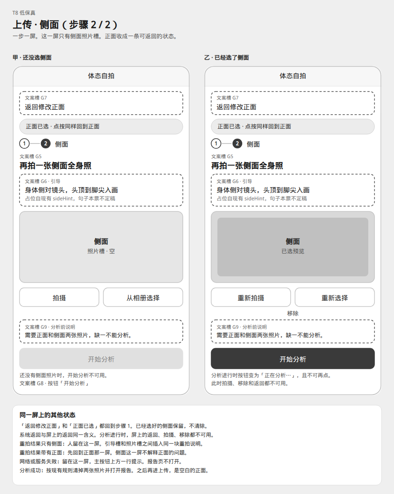
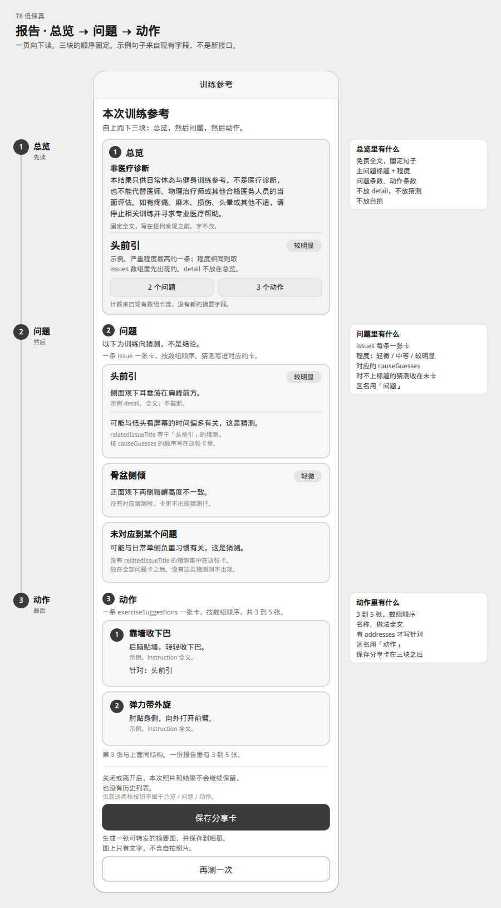
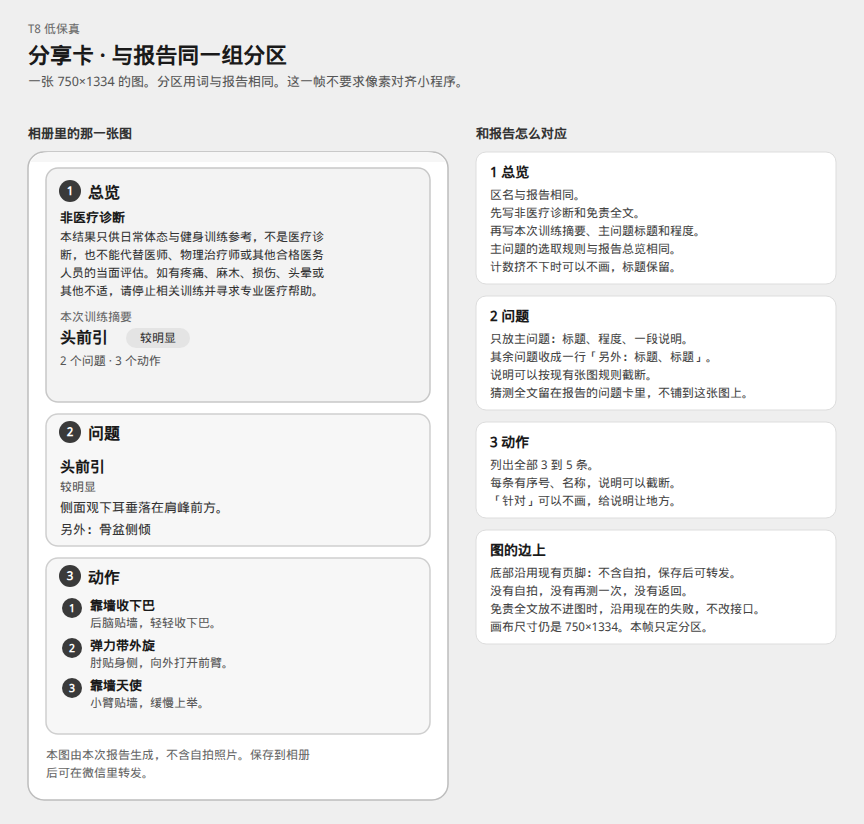

# T8 · 上传 / 报告线框（低保真）

**检查点：请用户确认线框后再开 T9（[#20](https://github.com/coppynight/posture-weapp/issues/20)）。**

本目录锁定上传和报告的信息架构，供确认。确认之前不要把页面布局合进 `main`，也不要开工 T9。

- 父规格：[#18](https://github.com/coppynight/posture-weapp/issues/18)
- 本票：[#19](https://github.com/coppynight/posture-weapp/issues/19)
- 灰盒只区分区域。配色、圆角、字号留到确认之后。
- [#18](https://github.com/coppynight/posture-weapp/issues/18) 已停掉只换皮的 [#15](https://github.com/coppynight/posture-weapp/issues/15)。这里不交付样式。

每张图有 SVG 源文件和同名 PNG。下面嵌的是 PNG，方便在 PR 里直接看。

## 这版钉死的节奏

1. **上传两屏。** 正面一屏，侧面一屏。同一时刻只有一个大照片槽。
2. **报告三块，顺序固定。** 先总览，再问题，再动作。一页向下读。
3. **分享卡用同样三个词。** 总览、问题、动作。一张图，不要求跟小程序逐像素对齐。

分析接口、免责全文、会话只活在这一次、分享卡仍是保存到相册的 750×1334 图，都保持现状。变的是页面怎么分步、报告怎么分区。

## 图例

| 画法 | 含义 |
| --- | --- |
| 实线灰盒 | 一块内容区域 |
| 虚线框 | 引导文案槽。框里的中文是占位，句子本票不定稿 |
| 深灰长按钮 | 这一步的主操作，可以点 |
| 浅灰长按钮 | 主操作还不可用 |
| 头前引、骨盆侧倾等 | 示例，用来标明现有字段落在哪。不是新的分析文案 |

## 屏与屏怎么走



两屏可以做成同一页的两个状态，或两个页面。客人同一时刻只看到一个照片槽。侧面的系统返回和屏上的「返回修改正面」是同一件事：回到正面，已经选好的侧面还留着。

## 1. 正面 · 步骤 1 / 2



源文件：[01-upload-front.svg](01-upload-front.svg)

```text
体态自拍
(1)——(2)  正面
文案槽 G1   拍一张正面全身照
文案槽 G2   正对镜头，头顶到脚尖入画
┌ 正面照片槽 ┐          ← 这一屏唯一的大槽
拍摄    从相册选择
文案槽 G3   无需登录。照片和结果只在本次打开期间使用。
[ 下一步 ]               ← 文案槽 G4；没照片时不可用
```

- 甲是还没选正面：没有「移除」，「下一步」不可用。打开小程序、再测一次、看完报告再回来，都是这一屏。
- 乙是已经选了正面：预览、重新拍摄、重新选择、移除都在这一屏。「下一步」进入侧面。侧面的大槽不出现在这里。
- 选图失败（格式不对、权限、没选到）时，一行提示贴在主按钮上方。

**重拍落到这一屏：** 分析结果的 `shots` 里有正面时，打开正面。预览保留。引导槽和照片槽之间插入重拍块，顺序是：

1. 请重拍或补拍
2. 这次没有出报告。请按提示重拍或补拍，然后再次分析。
3. 接口返回的 `summary`
4. 这一面的 `messages`
5. 拍摄核对，用完整的 `checklist`
6. 若侧面也在 `shots` 里，再加一行文案槽 G10：「侧面也要重拍。改完正面后，到侧面那一屏继续。」

收到结果时只路由一次。客人随后自己点「下一步」或「返回」。已经进了侧面之后，不因为结果里还写着正面再弹回正面。

## 2. 侧面 · 步骤 2 / 2



源文件：[02-upload-side.svg](02-upload-side.svg)

```text
体态自拍
文案槽 G7   返回修改正面
[ 正面已选 · 点按同样回到正面 ]   ← 细条，不是第二张大图
(1)——(2)  侧面
文案槽 G5   再拍一张侧面全身照
文案槽 G6   身体侧对镜头，头顶到脚尖入画
┌ 侧面照片槽 ┐
拍摄    从相册选择
文案槽 G9   需要正面和侧面两张照片，缺一不能分析。
[ 开始分析 ]             ← 文案槽 G8；没照片时不可用
```

- 正面还没选好时，到不了这一屏。
- 「返回修改正面」和「正面已选」都回到步骤 1，已选侧面保留。
- 分析进行时，按钮文案变为「正在分析…」，并且不可再点。拍摄、移除、屏上的返回同时不可用。
- 网络或服务失败：人留在这一屏，主按钮上方一行提示。报告不打开。
- 分析成功：按现有规则清掉两张临时照片，打开报告。之后再进上传，是空白的正面。
- 重拍结果只有侧面：人留在这一屏，引导槽和照片槽之间插入同一块重拍说明（上面第 1–5 项，对象换成侧面）。
- 重拍结果里有正面：先打开正面那一屏。侧面这一屏不解释正面的问题。

## 3. 报告 · 总览 → 问题 → 动作



源文件：[03-report.svg](03-report.svg)

导航标题仍是「训练参考」。页内标题仍是「本次训练参考」。下面三块按这个顺序，一页滚动：

```text
1  总览
   非医疗诊断
   免责全文（固定句子，写在任何发现之前）
   主问题标题 + 程度          例：头前引 · 较明显
   N 个问题 · N 个动作
2  问题
   以下为训练向猜测，不是结论。
   每条 issue 一张卡（数组顺序）
     标题 · 程度 · detail 全文
     对得上标题的猜测，写在这张卡里
   对不上标题的猜测，收在最后一张「未对应到某个问题」
3  动作
   每条 exercise 一张卡，3 到 5 张，数组顺序
     序号 · 名称 · instruction 全文
     有 addresses 时写「针对：…」
—— 三块到此结束 ——
关闭或离开后，本次照片和结果不会继续保留，也没有历史列表。
[ 保存分享卡 ]
生成一张可转发的摘要图，并保存到相册。图上只有文字，不含自拍照片。
[ 再测一次 ]
```

页底的说明和两枚按钮在三块卡片之后，单独成一块。

### 字段落点

全部来自现有 `report`。没有新的摘要字段，没有评分，没有把自拍放进报告。

| 现有数据 | 落在 |
| --- | --- |
| `disclaimer` | 总览卡顶部。小标题用现有的「非医疗诊断」。全文如下，不改字 |
| 程度最高的一条 `issues` | 总览里的主问题：只放标题和程度。程度相同则取数组里先出现的一条 |
| `issues.length`、`exerciseSuggestions.length` | 总览里的两个计数 |
| `issues[]` | 问题区。一条一张卡，按数组顺序，不按程度重排 |
| `causeGuesses[]` 且 `relatedIssueTitle` 等于某条问题标题 | 写进那张问题卡，按 `causeGuesses` 的数组顺序 |
| `causeGuesses[]` 没有 `relatedIssueTitle` | 问题区最后一张，标题为「未对应到某个问题」。没有这种猜测时，这张卡不出现 |
| 现有「以下为训练向猜测，不是结论。」 | 问题区标题下面，整区一句 |
| `exerciseSuggestions[]` | 动作区。一条一张卡，序号从 1 起，3 到 5 张 |
| `addresses` 有值 | 该动作卡最后一行，前缀用现有的「针对：」 |
| 现有会话说明、保存分享卡、再测一次 | 三块卡片下面 |

免责全文（与 `REPORT_DISCLAIMER` 相同）：

> 本结果只供日常体态与健身训练参考，不是医疗诊断，也不能代替医师、物理治疗师或其他合格医务人员的当面评估。如有疼痛、麻木、损伤、头晕或其他不适，请停止相关训练并寻求专业医疗帮助。

主问题的选法与现在分享卡选主问题的规则相同：`marked` 高于 `moderate`，高于 `mild`；程度相同保留先出现的那条。示例里头前引刚好排在第一条。它若排在后面，总览仍指向它，问题卡保持原顺序。

程度用现有三个词：轻微、中等、较明显。

问题区把现在的「看到的问题」和「可能的原因」收成一块，区名用「问题」。动作区的区名用「动作」。这是要确认的用词。

报告不在会话里时，沿用现在的行为：回到上传，并且是空白的正面。离开报告页仍结束这一次查看。再测一次仍清空会话，回到空白的正面。相册权限弹层不是新的一屏；拒绝之后报告还在。

## 4. 分享卡 · 同一组分区



源文件：[04-share-card.svg](04-share-card.svg)

一张图，不是小程序里的另一页。画布仍是 750×1334。客人从报告页「保存分享卡」写入相册，再自己转发。图上没有自拍。

```text
1  总览
   非医疗诊断 + 免责全文
   本次训练摘要
   主问题标题 + 程度
   N 个问题 · N 个动作     ← 挤不下可以不画，主问题标题保留
2  问题
   主问题的标题、程度、一段说明
   另外：其余问题的标题
3  动作
   全部 3 到 5 条：序号、名称、一句说明
页脚  本图由本次报告生成，不含自拍照片。保存到相册后可在微信里转发。
```

| 报告上 | 分享卡上 |
| --- | --- |
| 总览里的免责和主问题 | 总览。主问题是同一条 |
| 每一张问题卡，含猜测全文 | 问题区只留主问题，其余标题收成「另外：」。说明可以按现在的张图规则截断 |
| 每一张动作卡的全文 | 动作区列出全部条目。说明可以截断。「针对」可以不画 |
| 猜测 | 留在报告的问题卡里 |

免责全文放不进这张图时，沿用现在的失败（报告不完整），不改接口。小程序页面的转发入口保持关闭。

## 文案槽

虚线框里的句子是占位。确认线框时可以改句子，槽的位置不动。

| 槽 | 屏 | 现在占位的句子 | 现有文案键 |
| --- | --- | --- | --- |
| G1 | 正面标题 | 拍一张正面全身照 | 现 `captureTitle` 是两张一起说的，分步后用这一句 |
| G2 | 正面引导 | 正对镜头，头顶到脚尖入画 | `frontHint` |
| G3 | 正面本次说明 | 无需登录。照片和结果只在本次打开期间使用。 | `captureLead` 的后半，只放在正面 |
| G4 | 正面主按钮 | 下一步 | 新 |
| G5 | 侧面标题 | 再拍一张侧面全身照 | 新 |
| G6 | 侧面引导 | 身体侧对镜头，头顶到脚尖入画 | `sideHint` |
| G7 | 侧面返回 | 返回修改正面 | 新 |
| G8 | 侧面主按钮 | 开始分析 / 正在分析… | `submit` / `submitting` |
| G9 | 侧面分析前 | 需要正面和侧面两张照片，缺一不能分析。 | `needBoth` |
| G10 | 正面重拍，且侧面也要重拍 | 侧面也要重拍。改完正面后，到侧面那一屏继续。 | 新 |

重拍块的标题、引导、核对标题沿用现有「请重拍或补拍」「这次没有出报告…」「拍摄核对」。`summary`、`messages`、`checklist` 仍由接口给。

## 请确认

1. 正面一屏、侧面一屏，同一时刻只有一个大照片槽。
2. 侧面可以回到正面修改；已选的侧面保留。
3. 重拍含正面时回到正面；只有侧面时留在侧面。重拍块插在引导槽和照片槽之间。
4. 报告先总览，再问题，再动作。
5. 猜测写进对应的问题卡；对不上标题的，放在问题区最后。
6. 免责全文在总览顶部，位于任何发现之前，句子不改。
7. 总览和分享卡的主问题是同一条。问题列表按数组顺序，不按程度重排。
8. 分享卡的区名也是总览、问题、动作。猜测全文留在报告上。
9. 分析接口、会话只活在这一次、不落库，保持现状。

**请用户确认线框后再开 T9（[#20](https://github.com/coppynight/posture-weapp/issues/20)）。**
